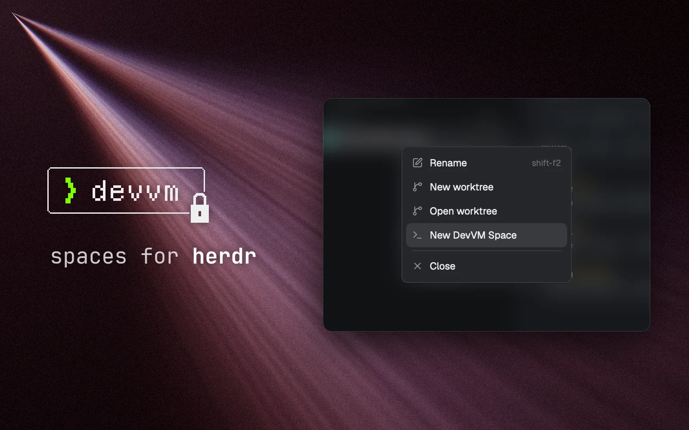

# DevVM spaces for Herdr

Right-click a Git space and choose **New DevVM Space** to open a branch in a DevVM guest. The mod creates a Git worktree on the source host, DevVM clones its committed files into the guest, and Herdr opens a space there. New tabs and splits in that space run in the guest too.

The source checkout can be local or on a macOS or Linux machine connected to Herdr over SSH. This is a personal mod, not a built-in Herdr feature. Install it only if you trust it to run commands as your desktop and source users.



See the [Herdr Mods gallery recipe](https://github.com/agneym/herdr-devvm-mod/blob/main/RECIPE.md).

## Prerequisites

- **Herdr App 0.1.16** on Linux or macOS. The release bundles patched copies of this version’s default layout and mods.
- **Herdr Core (`hc`) 0.1.13 or later in the stable 0.1.x series** on the desktop and any SSH source. The tested baseline is 0.1.13.
- [**DevVM 0.1.0**](https://github.com/devvmhq/devvm/blob/v0.1.0/docs/content/docs/getting-started/install.md) already installed and working on the source host, with Git (`rev-parse --path-format`) and OpenSSH 8.7+. The mod does not install DevVM or its dependencies.

Source hosts can run Linux (x86_64 or arm64) or macOS 13+. The mod has not been live-tested on macOS, and upstream DevVM has not been tested on Intel Macs. Windows and Herdr sources registered with `--via` are not supported.

## Install and activate

Open Herdr App 0.1.16 once to create its default files. Download `herdr-devvm-mod.tar.gz` from the [latest release](https://github.com/agneym/herdr-devvm-mod/releases/latest), not GitHub’s **Source code** archive. Extract it and run the installer from the extracted directory. No Python is needed.

```sh
tar -xzf herdr-devvm-mod.tar.gz
cd herdr-devvm-mod
sh install.sh
herdr-app do layout.switch --name main-devvm
```

The installer creates `layouts/main-devvm.json` and `mods/devvm-{spaces,menu,worktree}` without modifying existing files. Run `sh install.sh --check` to validate the bundle, app version, and destination without writing files. For host checks, run `devvm doctor` on the source host or use **Check setup** in the dialog. For custom paths, pass `--app PATH` or `--app-home DIR`. The installer and running app must use the same app home (`$HERDR_APP_HOME`, otherwise `${XDG_CONFIG_HOME:-$HOME/.config}/herdr-app`).

### Remote checkouts

Skip this for local checkouts; no SSH server is needed. For a remote checkout, use an existing SSH alias or `user@host`, with the same account for direct SSH and Herdr. Verify the host fingerprint and make sure batch SSH works with credentials available to Herdr:

```sh
ssh -o BatchMode=yes -- devbox true
hc machine add devbox --name devbox  # Only if it isn't already registered
```

Put ports and jump hosts in SSH config. Pass the SSH **target** to `install.py --check --source`, even if the machine has a different display name in Herdr.

## Create a DevVM space

1. Open a Git space, then right-click it in the sidebar. **New DevVM Space** appears when Herdr detects Git and DevVM 0.1.0 on the checkout’s host.
2. Enter a branch name and select **Create** or press Enter. A new branch starts at the source checkout’s current `HEAD`. An existing branch must not be checked out elsewhere. **Check setup** runs the host checks without creating a worktree or VM.
3. Leave the dialog open. First boot can take several minutes. Closing it is not a reliable way to cancel; if it closes during setup, check `devvm ls` and the host logs before retrying.

Only committed files are copied. Uncommitted, untracked, and ignored files stay on the host. Guest edits do not sync back automatically, and retrying does not refresh an existing guest clone. See [Working on a clone](https://github.com/devvmhq/devvm/blob/v0.1.0/docs/content/docs/using/clone.md) for fetching guest commits.

**Create** can install Core inside the guest and register it in Herdr. The connection uses DevVM’s pinned guest host key over loopback, directly for local checkouts or through the source SSH host for remote ones. The mod does not change your SSH config or expose a public guest SSH port.

## Configure worktrees

The mod uses `git worktree add` by default. Set `worktrees.directory` in the desktop app’s `settings.json` to change the worktree root (default: `~/.herdr/worktrees` on the source host). Use an absolute path on that host or a path starting with `~/`, not a Windows drive path.

### Optional: use a different worktree tool

Set `worktrees.devvmAdapter` to the absolute path of a **trusted executable on the source host**. The mod invokes it from the source checkout, passing each argument separately:

| Invocation | Expected behavior |
| --- | --- |
| `adapter create <path> <branch> <base-commit>` | Create the branch at the supplied commit and check it out in a linked worktree at `<path>`. |
| `adapter existing <path> <branch>` | Check out the existing local branch in a linked worktree at `<path>` without resetting it or forcing a second checkout. |

Exit `0` on success and nonzero on failure. No machine-readable output is needed. The mod verifies the resulting checkout’s branch and repository, and skips the adapter if a matching worktree already exists. Setup checks verify that the adapter is executable without running it.

For example, point `worktrees.devvmAdapter` at an executable script like this on the source host ([Worktrunk 0.82.0](https://github.com/max-sixty/worktrunk/releases/tag/v0.82.0)):

```sh
#!/bin/sh
set -eu
case "$1" in
    create) exec wt switch --no-hooks --no-cd --create --base "$4" --path "$2" "$3" ;;
    existing) exec wt switch --no-hooks --no-cd --path "$2" "$3" ;;
    *) exit 2 ;;
esac
```

## Troubleshooting

Fix the issue and choose **Retry**, or reopen the dialog from the same repo and enter the same branch. The mod reuses matching worktrees, guest registrations, and spaces; it does not delete work after a failure. **Copy details** includes command output and host or repo paths. Redact it before sharing.

| If this happens | Try this |
| --- | --- |
| **New DevVM Space** is missing | Check that `main-devvm` is active, the space is in a Git repo, and DevVM is installed on the machine that owns the checkout. |
| Host check fails | Run `devvm doctor` on the source host and check that Herdr can find the required tools. For remote sources, also verify batch SSH and make sure remote shell startup does not print to stdout. |
| Worktree setup fails | Check the branch and `worktrees.directory`. Use a different branch if the requested one is checked out elsewhere. |
| Boot fails or times out | Check `devvm ls` and the log from **Copy details**. The mod waits up to 10 minutes. If DevVM needs input or more time, run `devvm --clone` interactively from the exact worktree, then exit the guest shell and retry. |
| Guest registration or layout fails | Check **Settings → Machines** and `herdr-app status`. To start a stopped guest, run `devvm host --here` from its worktree. If the guest pin is missing or mismatched, inspect the guest rather than disabling host key verification. |

## Clean up or uninstall

- Closing a space does not stop the VM. To remove the guest, save its work first, forget the guest machine in Herdr if you no longer need it, and run `devvm rm` interactively from its host worktree. Remove the Git worktree last.
- To remove or reinstall the mod, switch back with `herdr-app do layout.switch --name main`, then back up and move the four installed paths listed above. Switch back to `main` before upgrading Herdr; copied layouts and mods don’t update with the app.
- Registered guests still need the installed `bridge.sh` at the same path to reconnect. Moving the app home, changing the SSH target, or moving DevVM’s data directory can require re-registering the guest.

## Build and test

Python is only needed to build or test from source. The release workflow runs `python3 -B build_release.py /path/to/herdr-app/defaults dist` against the upstream v0.1.16 source and smoke-tests the archive with `sh tests/check-release.sh dist/herdr-devvm-mod.tar.gz`.

```sh
python3 -B -m unittest discover -s tests -v
node --test tests/dialog.test.mjs  # Node.js 20+
sh -n host.sh && sh -n bridge.sh
```

For native render checks, run `sh tests/check-herdr.sh /path/to/app-checkout /path/to/herdr-app /path/to/hc` with the Herdr App v0.1.16 tag and executable. On Linux without system fonts, set `DEVVM_TEST_FONT_DIR` to a fallback font directory. This does not boot a VM. For a live smoke test, use a disposable Core session and Git repo, create a guest space, open a new tab in it, then repeat the same branch and confirm that Herdr selects the existing space.

The `mods/` directory is a snapshot of the release bundle for the Herdr Mods gallery. Refresh it from the built archive when updating the gallery entry; make implementation changes in the source files, not the snapshot.

## License

Original mod code is [MIT](LICENSE). The shipped Herdr code adapted in the gallery snapshot and release bundle remains under [Herdr App’s upstream license](LICENSE.herdr-app).
