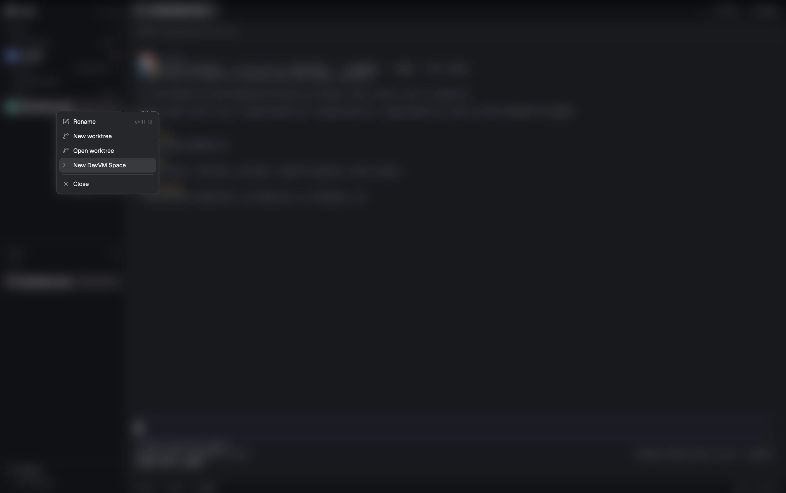

# DevVM spaces for Herdr

Right-click a Git space in Herdr’s sidebar and choose **New DevVM Space** to open a branch in a DevVM guest. The source checkout stays on its host; new tabs and splits in the guest space run inside the guest.

## What you see

The usual space context menu gains one row, **New DevVM Space**, with a terminal icon and the standard hover highlight. This build opens the menu in a 220 × 280 popup. The blur in the preview is only a screenshot edit.

The row opens a 560 × 360 modal with a title, a short explanation, a 32 px branch field, and right-aligned buttons. It uses the active theme’s popover background, 13 px body text, muted help, accent progress and blocked/error colors. The sidebar and its agent status indicators are otherwise unchanged.

## How it behaves

- The row appears only after the source host passes the Git and DevVM probe. It works with a local checkout or a checkout on a directly SSH-connected Herdr machine.
- **Check setup** checks prerequisites without creating a worktree or booting a guest. Type a branch and press Enter or choose **Create** to create or reuse a linked worktree, clone its committed files into a guest, and open or select the guest space.
- Progress replaces the branch field while work is in flight. Escape dismisses an idle dialog. Failures show advice and offer **Retry** and **Copy details**. A matching worktree, guest registration or space can be reused on retry.

## Built from

This is one integration with three cooperating mods built from Herdr App 0.1.16’s shipped views:

- `mods/devvm-spaces` preserves the shipped Spaces view and routes its space popup to `devvm-menu` with the space target.
- `mods/devvm-menu` preserves the stock items. It locates the source space, uses `exec` on `space.machine` to probe the host, and uses `openOverlay` to open `devvm-worktree` with the source space ID and `action: "devvm"`.
- `mods/devvm-worktree` preserves ordinary worktree handling and dispatches the DevVM action to `dialog.js`. The dialog uses `gpui-kit` and `gpui-base`; `devvm.js`, `host.sh` and `bridge.sh` coordinate Git, DevVM, pinned SSH and Herdr Core. The helpers run programs on the source host, may install Core in the guest over the network, and register the guest in Herdr. No global key changes are needed.

A layout must reference `devvm-spaces` instead of the shipped `spaces` block to activate the integration. Use the [release installer](https://github.com/agneym/herdr-devvm-mod#install-and-activate) for the matching `main-devvm` layout and all three mods; copying the gallery files alone does not activate the menu. Do not overwrite shipped mods or the active layout.

## Watch out

Target Herdr App 0.1.16, Core 0.1.13 or later in the stable 0.1.x series, and an already working DevVM 0.1.0 installation. Windows and Herdr sources registered with `--via` are not supported. A new branch starts at the source checkout’s `HEAD`; an existing branch must not be checked out elsewhere. Uncommitted files stay on the host and guest edits do not sync back automatically. Closing the dialog or space is not a reliable way to cancel setup or stop the guest. Keep the pinned guest host key checks and redact diagnostic details before sharing.

## Done when

- The stock menu still works, and **New DevVM Space** appears for a supported Git checkout but not for a checkout without working DevVM.
- **Check setup** creates neither a worktree nor a VM, and Escape closes the idle dialog.
- In a disposable repo, **Create** opens the committed branch in a guest. A new tab and split both run there. Repeating the same branch selects the existing space without creating a second guest.
